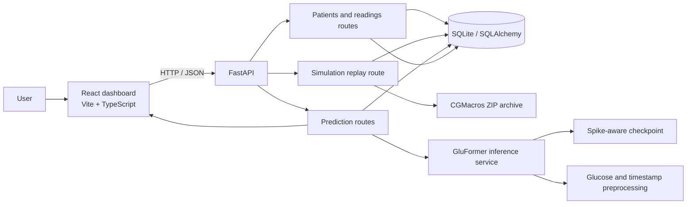

# Diabetes Digital Twin — GluFormer-Based Glucose Forecasting

A student research prototype for organizing patient records, visualizing glucose readings, replaying CGMacros sample data, and forecasting short-term glucose trends with a GluFormer model. Forecasts are experimental research estimates; this application is not a medical device and must not be used to make treatment decisions.

## 1. Project overview

The project combines a React dashboard, a FastAPI service, a relational database, CGMacros data replay, and a PyTorch GluFormer checkpoint. A user can create a patient record, enter readings, inspect a glucose history, and request a 60-minute forecast when 180 regularly spaced readings are available.

The application has no connection to a live CGM or wearable. Its “Live Monitoring” screen plays archived CGMacros readings into the database as a simulated stream.

## 2. Team details

| Detail | Information |
|---|---|
| Team name | **[Add team name]** |
| Team lead | **[Add name, role, and contact]** |
| Team members | **[Add each member’s name, role, and institution ID]** |

## 3. College information

**University of Engineering & Management, Kolkata**

## 4. Problem statement

Glucose levels can change throughout the day in response to meals, activity, medication, and individual physiology. Reviewing isolated readings can make it difficult to understand recent trends. This project explores whether a short-horizon time-series model can summarize recent CGM data and estimate glucose over the next hour in a digital-twin-style dashboard.

## 5. Healthcare use case

The prototype demonstrates a research workflow for viewing a patient profile alongside timestamped glucose and optional wearable readings. It can plot historical readings and, when the model and input requirements are met, display a 12-step forecast and a research spike flag. It does not provide diagnosis, alerts for clinical use, treatment recommendations, or personalized medical advice.

## 6. Technical stack

| Layer | Technologies used |
|---|---|
| Frontend | React 18, TypeScript, Vite, Tailwind CSS, React Router, Recharts, Axios, Lucide icons |
| Backend/API | Python, FastAPI, Pydantic, SQLAlchemy, Uvicorn |
| Data/model | SQLite by default, PyTorch, NumPy, pandas |
| Tests | pytest, FastAPI TestClient, held-out GluFormer inference test |

## 7. System architecture



The React app reads and writes data through the FastAPI routes. Patient and reading records are stored in SQLite by default. The replay route reads archived CGMacros rows; the prediction route invokes the local PyTorch model service.

## 8. AI/ML model

The reported experiment fine-tuned GluFormer on CGMacros using a spike-aware loss. The application is configured to load `checkpoints/best_gluformer_spike_aware.pt`; its checkpoint metadata records epoch 2, a 30 mg/dL spike threshold, and spike-loss weight 4. The project also contains `checkpoints/best_gluformer_cgmacros.pt` as a baseline checkpoint. No model training or retraining occurs when the app starts.

Forecasting accepts **180 glucose values at five-minute intervals** (15 hours of input) and produces **12 values at five-minute intervals** (the next 60 minutes). The local service uses fixed glucose scaling, five calendar/time features, a 60-reading decoder context, and numeric CGMacros subject IDs. See `app/services/gluformer.py` for the implementation.

For the application’s spike flag, predicted rise is the greatest predicted glucose value minus the latest observed value, floored at zero. A spike is flagged when this rise is **at least 30 mg/dL** within the 60-minute forecast window. This is a project research definition, not a clinical threshold or alarm.

### Reported experimental evaluation

The following results were supplied for the project’s experiment. They are reported for **six held-out CGMacros participants** and are **not clinical validation**. The current repository does not include the full experiment logs or an evaluation script to independently recalculate this table.

| Metric | Reported result |
|---|---:|
| Fine-tuned RMSE | 15.1517 mg/dL |
| Fine-tuned MAE | 10.9015 mg/dL |
| Spike precision | 33.38% |
| Spike recall | 15.96% |
| Spike F1 | 21.60% |
| RMSE improvement over pretrained | 18.57% |
| MAE improvement over pretrained | 15.15% |
| F1 improvement over pretrained | 90.31% |

The spike precision and recall show that spike detection remains limited, especially in recall. These figures should be interpreted as experimental results on a small held-out cohort, not evidence of clinical performance.

## 9. Features and application workflow

- **Overview:** summarizes patient count and recent readings. Risk status remains “not assessed”; the page does not provide a clinical risk classification.
- **Patient records:** create and search records with patient ID, demographics, diabetes type, HbA1c, BMI, and medications.
- **Patient details:** record a timestamped glucose reading with optional heart rate, activity, and METs; view recent readings and a glucose chart.
- **Predictions:** request a forecast when exactly 180 available readings are spaced five minutes apart; view the historical-versus-predicted chart, predicted maximum, maximum rise, and 30 mg/dL spike flag.
- **Live Monitoring:** replay CGMacros subject 001 as a simulated stream. The replay writes archived readings to the backend; it is not a live sensor connection.

## 10. Project structure

```text
.
├── app/
│   ├── main.py                   # FastAPI app and startup initialization
│   ├── database.py               # SQLAlchemy engine and session setup
│   ├── models.py                 # Patient and glucose-reading tables
│   ├── schemas.py                # API request/response schemas
│   ├── routes/
│   │   ├── patients.py           # Patient endpoints
│   │   ├── glucose.py            # Reading endpoints
│   │   ├── predictions.py        # Model status and forecast endpoints
│   │   └── simulation.py         # CGMacros replay endpoint
│   └── services/
│       ├── gluformer.py          # Checkpoint loading and inference
│       └── simulation.py         # CGMacros archive reader
├── checkpoints/
│   ├── best_gluformer_spike_aware.pt
│   └── best_gluformer_cgmacros.pt
├── frontend/
│   ├── src/pages/                # Overview, patients, details, predictions, replay
│   ├── src/services/api.ts       # Frontend API client
│   ├── package.json
│   └── vite.config.ts
├── tests/
│   ├── test_api.py
│   └── test_gluformer_inference.py
├── CGMacros_dateshifted365 (1).zip
├── gluformer_cgmacros_subject_split.npz
├── requirements.txt
├── .env.example
└── README.md
```

The SQLite database is created locally at startup. `.env`, database files, Python caches, `frontend/node_modules`, and `frontend/dist` are ignored by `.gitignore`.

## 11. Prerequisites and local setup

- Python 3.10 or newer
- Node.js 20.19 or newer
- Git
- The model checkpoint and CGMacros archive files listed above for local inference and replay

Clone the repository and install the backend dependencies. In Windows PowerShell:

```powershell
git clone https://github.com/Soumyadeep99/Digital-Twin.git
Set-Location Digital-Twin
py -3.10 -m venv .venv
.venv\Scripts\Activate.ps1
python -m pip install --upgrade pip
python -m pip install -r requirements.txt
if (!(Test-Path .env)) { Copy-Item .env.example .env }
uvicorn app.main:app --reload
```

The API is available at `http://127.0.0.1:8000`; interactive API documentation is at `http://127.0.0.1:8000/docs`.

In a second terminal, install and start the frontend:

```powershell
Set-Location Digital-Twin\frontend
if (!(Test-Path .env)) { Copy-Item .env.example .env }
npm ci
npm run dev
```

Open `http://localhost:5173`. If the API is hosted elsewhere, set `VITE_API_BASE_URL` in `frontend/.env`. The backend reads `DATABASE_URL`, `GLUFORMER_CHECKPOINT`, `CGMACROS_ZIP`, and `FRONTEND_ORIGINS` from its environment; configure these names in the backend `.env` for a non-default setup. Do not commit `.env` files or credentials.

To run the inference regression test:

```powershell
.\.venv\Scripts\python.exe -m pytest tests\test_gluformer_inference.py -q
```

## 12. API endpoints

Interactive schemas and request examples are available at `/docs` while the backend is running.

| Method | Endpoint | Purpose |
|---|---|---|
| `GET` | `/health` | Health check |
| `GET` | `/patients` | List patients |
| `POST` | `/patients` | Create a patient |
| `GET` | `/patients/{patient_id}` | Get a patient |
| `POST` | `/patients/{patient_id}/readings` | Add a glucose/wearable reading |
| `GET` | `/patients/{patient_id}/readings?limit=180` | List readings in timestamp order |
| `GET` | `/predictions/status` | Report checkpoint and inference readiness |
| `POST` | `/predictions/forecast` | Forecast the next 12 five-minute glucose values |
| `POST` | `/simulation/replay` | Import archived CGMacros readings into a patient |

`POST /predictions/forecast` accepts `patient_id` and exactly 180 readings. The service rejects input that is not spaced exactly five minutes apart. A successful response includes `predictions`, `max_predicted_rise`, `spike_flag`, `model`, and a research-only label. The route uses the numeric patient ID as the GluFormer subject ID; for meaningful subject-specific inference, that ID must correspond to the intended numeric CGMacros participant ID. The patient table does not currently store a separate CGMacros subject mapping.

`POST /simulation/replay` accepts a patient ID, numeric CGMacros subject ID, optional replay limit (1–500), and optional start time. The frontend's Live Monitoring page requests 24 readings from subject 001.

## 13. Checkpoint, preprocessing, and inference status

The local checkpoint is a PyTorch training bundle with a `model_state_dict`. The service in `app/services/gluformer.py` implements the compatible architecture and preprocessing; it loads the checkpoint strictly. `tests/test_gluformer_inference.py` uses held-out inputs from the supplied NPZ split and checks 12 output values, five-minute timestamps, finite inverse-scaled values in range, and an RMSE sanity bound. The current service sets `inference_ready` after strict checkpoint loading, and the regression test passes in this workspace.

The original upstream source/config files are **not vendored as separate files** in this repository; the local service follows the published [Hugging Face Gluformer implementation and configuration](https://huggingface.co/njeffrie/Gluformer/tree/main). In the current checkout, a compatible implementation and preprocessing are present in `app/services/gluformer.py`, strict checkpoint loading succeeds, and the held-out regression test passes. Therefore, it would be inaccurate to describe verified inference as unavailable in this checkout. If the checkpoint or compatible implementation is missing or fails to load, the status endpoint reports the problem and forecasting returns unavailable rather than fabricating a result. Re-run the held-out test when changing the model or preprocessing.

The model was tested with CGMacros cohort IDs, not independently validated on arbitrary new patients. The current patient-ID-to-subject-ID convention is a numeric identity assumption, not a persisted mapping or a clinical personalization guarantee. The frontend may show patient-specific prediction output when the backend reports readiness and the reading interval requirements are met; this does not establish clinical validity.

## 14. Dataset source and usage

The project includes `CGMacros_dateshifted365 (1).zip` for replay and `gluformer_cgmacros_subject_split.npz` for model evaluation. The replay reader selects five-minute samples from the archive's CGM fields and carries through available heart rate, activity, and METs values.

CGMacros is a multimodal research dataset with CGM, activity, dietary/macronutrient, and participant information. The source dataset is available through [PhysioNet](https://physionet.org/content/cgmacros/1.0.0/) and its [project repository](https://github.com/PSI-TAMU/CGMacros). Review and follow the dataset's access, citation, and license requirements before using or redistributing any source data. Dataset terms are separate from this application's code license.

## 15. Privacy, limitations, and medical disclaimer

- The sample records are synthetic; the bundled CGMacros archive is research data. Do not upload real patient identifiers or sensitive health information to this prototype.
- The current API has no authentication or authorization layer. Do not expose it to the public internet or use it for production patient data.
- CGMacros participants and six held-out participants are not a substitute for clinical validation or representative prospective evaluation.
- Performance can vary by participant, device, time range, and data quality. The low reported spike recall is a material limitation.
- Input readings must be complete and exactly five minutes apart. There is no automatic gap filling or live device ingestion.
- Forecasts and spike flags are research estimates only. They are not a diagnosis, medical advice, clinical alerts, or a substitute for a licensed clinician or validated device.

## 16. Open-Source License

The project code authored for this repository by **Soumyadeep Jana** is licensed under the MIT License; see the root [`LICENSE`](LICENSE) file. This license applies only to project material that the copyright holder owns or is authorized to license. It does not relicense or grant rights to third-party material.

GluFormer source or reference implementation, model checkpoints and weights, the CGMacros dataset and derived data, dependencies, and other externally sourced assets remain subject to their respective original licenses, access conditions, and usage terms. Verify those terms and obtain any required permissions before using or redistributing them. The CGMacros dataset's terms are separate from this project's code license.

## 17. Project Resources

- **Project Presentation:** [View Diabetes Digital Twin Presentation on Gamma](https://gamma.app/docs/Diabetes-Digital-Twin-GluFormer-Based-Glucose-Forecasting-p1q5nqwhrq2pw5h)
- **System Architecture Diagram:** [View Architecture PDF](https://github.com/Soumyadeep99/Digital-Twin/blob/main/diabetes_digital_twin_architecture.pdf)
- Architecture diagram: Mermaid diagram above.

## 18. Demo video

Required Unstop submission video (15–20 minutes, unlisted YouTube): [**[Canva URL]**](https://canva.link/iumrntegegzjo1h)

## 19. Contributions

1. Open an issue describing a reproducible bug or proposed improvement.
2. Create a focused branch and keep changes limited to that improvement.
3. Run the relevant checks, including the GluFormer held-out inference test when changing model or preprocessing code.
4. Open a pull request with a concise summary, setup notes, and test results. Do not include `.env`, database files, or private patient data.

## 20. Acknowledgements

This prototype uses the Gluformer model implementation and preprocessing reference published by the Gluformer contributors, the CGMacros dataset and its maintainers, and the open-source FastAPI, PyTorch, SQLAlchemy, React, Vite, and Recharts communities. Please cite the Gluformer work and CGMacros source when presenting results derived from them.

---

## Unstop submission items still needed

- Team name and member names, roles, and institution IDs
- Exported architecture diagram link/file
- Presentation/slides link/file
- Required 15–20-minute unlisted YouTube demo URL
- Confirmation of whether Unstop requires the original Gluformer source/config files to be included verbatim; this checkout currently contains a compatible local implementation and test, but not the upstream files as separate vendored artifacts
